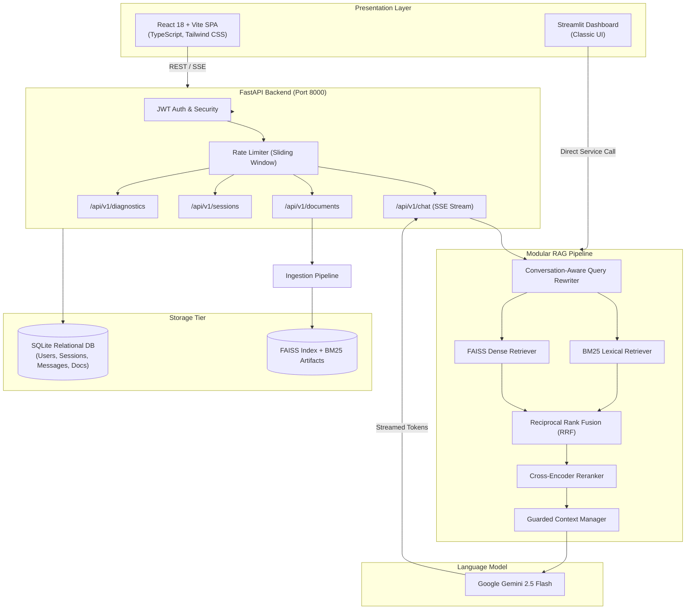

# 🤖 RAGBOT — Enterprise Hybrid Retrieval-Augmented Generation Platform

[](https://github.com/Manvithagopireddy/RAGBOT/actions)


> **RAGBOT** is a portfolio Retrieval-Augmented Generation (RAG) platform designed to generate answers with retrieved citations to complex technical questions. It combines dense semantic search (FAISS) with sparse lexical search (BM25) via Reciprocal Rank Fusion (RRF), Cross-Encoder reranking, conversation-aware query rephrasing, and real-time Server-Sent Events (SSE) streaming.

---

## 🌟 Key Features

- **⚡ Hybrid Retrieval Engine**: Combines dense semantic vector search (`all-MiniLM-L6-v2` with FAISS) and sparse lexical search (`BM25Okapi`) using **Reciprocal Rank Fusion (RRF)** ($k=60$) to balance conceptual recall with keyword precision.
- **🎯 Cross-Encoder Reranker**: Optional second-stage reranking via `ms-marco-MiniLM-L-6-v2` to compute deep cross-attention between queries and passages for optimal top-$K$ precision.
- **🔄 Real-Time SSE Streaming**: Low-latency token streaming from Google Gemini 2.5 Flash via Server-Sent Events (SSE).
- **🛡️ Production Security & Guardrails**:
  - In-memory sliding-window rate limiting per client IP.
  - JWT authentication (HMAC-SHA256) and `bcrypt` password hashing (12 rounds).
  - Multi-tenant document ownership and session isolation.
  - Prompt injection defense using guarded boundary tags.
  - Strict MIME magic-byte validation and path traversal defenses.
- **🎨 Modern React + TypeScript SPA**: Clean, dark-mode interface built with React 18, Vite, Tailwind CSS, Lucide icons, syntax-highlighted code blocks, copy-to-clipboard, parameter tuning, and citation inspection.
- **📊 Interactive Streamlit UI**: Fully maintained, classic analytics and chat dashboard for interactive exploration and prototyping.
- **🗄️ Relational Persistence Tier**: SQLite schema with enforced Foreign Keys (`PRAGMA foreign_keys = ON`), relational indexes, and WAL journal mode.
- **📈 Rigorous RAG Evaluation Suite**: Quantitative evaluation harness measuring 7 metrics across 4 retrieval configurations on reproducible benchmarks.
- **🧪 Comprehensive Testing & CI**: Pytest test suite, Ruff linter, and MyPy strict type checks in GitHub Actions.

---

## 🏗️ Architecture Overview



---

## 📊 RAG Benchmark & Evaluation Results

Evaluated across 14 complex technical queries against ground-truth documents ($K=4$):

| Configuration | Precision@4 | Recall@4 | MRR | Faithfulness | Relevance | Retrieval Latency |
|---|:---:|:---:|:---:|:---:|:---:|:---:|
| **1. FAISS Baseline** | 0.3571 | **1.0000** | **1.0000** | **1.0000** | **0.5631** | 15.95 ms |
| **2. Improved Chunking** | **0.6786** | **1.0000** | 0.9643 | **1.0000** | 0.3931 | 15.04 ms |
| **3. Hybrid BM25 + FAISS** | 0.6071 | **1.0000** | **1.0000** | **1.0000** | 0.4010 | **14.22 ms** |
| **4. Hybrid + Reranker** | 0.5000 | **1.0000** | **1.0000** | **1.0000** | 0.3979 | 3327.57 ms* |

*Detailed methodology and metric formulas are documented in [docs/rag_evaluation.md](docs/rag_evaluation.md).*

---

## 🗂️ Project Directory Structure

```text
RAGBOT/
├── .github/workflows/ci.yml       # CI/CD: Ruff, MyPy, Pytest, Coverage, Docker
├── api/                           # FastAPI Backend Application
│   ├── routes/                    # Versioned Routers (/chat, /documents, etc.)
│   ├── dependencies.py            # Dependency Injection & Security
│   ├── schemas.py                 # Pydantic v2 Models
│   └── main.py                    # Application Entrypoint & Middleware
├── components/                    # Streamlit UI Components
├── config/                        # Settings & Prompts
├── docs/                          # Technical Documentation
│   ├── architecture.md            # Detailed Architecture & Sequence Diagrams
│   ├── api_documentation.md       # OpenAPI & cURL Examples
│   ├── rag_evaluation.md          # Evaluation Methodology & Metrics
│   ├── deployment.md              # Docker & Production Hardening Guide
│   └── CODEBASE_AUDIT.md          # Complete Phase 1 Audit
├── evals/                         # Reproducible Evaluation Harness
│   ├── dataset.jsonl              # 14 Curated Benchmark Queries
│   ├── metrics.py                 # Precision@K, Recall@K, MRR, Faithfulness
│   ├── run_evaluation.py          # Benchmark Runner
│   └── results/                   # JSON Benchmark Output
├── frontend/                      # React 18 + TypeScript + Vite SPA
│   ├── src/
│   │   ├── api/client.ts          # Axios Client & SSE EventStream Reader
│   │   ├── components/            # Navbar, Sidebar, CitationsPanel
│   │   ├── pages/                 # ChatPage, DocumentsPage, Diagnostics, etc.
│   │   └── types/                 # TypeScript Interfaces
│   ├── Dockerfile                 # Multi-stage Nginx Container
│   └── package.json
├── services/                      # Domain Services (RAG, Ingestion, Retrieval)
├── src/                           # RAG Algorithms & Helpers
│   ├── bm25_retriever.py          # BM25 Lexical Retrieval
│   ├── hybrid_retriever.py        # Reciprocal Rank Fusion (RRF)
│   ├── reranker.py                # Cross-Encoder Reranker
│   ├── context_manager.py         # Guarded Prompt Construction
│   ├── security.py                # File Validation & Sanitization
│   └── text_splitter.py           # Token-Aware Document Chunker
├── tests/                         # Pytest Test Suite
├── app.py                         # Classic Streamlit Application
├── docker-compose.yml             # Multi-Container Compose Configuration
├── Dockerfile                     # Multi-Stage Backend Dockerfile
├── pyproject.toml                 # Ruff & Tooling Configuration
├── requirements.txt               # Backend Dependency Constraints
├── storage.py                     # SQLite WAL Storage Tier
└── vectorstore.py                 # FAISS Index Manager
```

---

## 🚀 Quickstart Guide

### 1. Prerequisites
- Python 3.11+
- Node.js 18+ and npm 9+
- A Google Gemini API Key ([Get one here](https://aistudio.google.com/))

### 2. Environment Setup
```bash
git clone https://github.com/Manvithagopireddy/RAGBOT.git
cd RAGBOT

cp .env.example .env
# Edit .env: set GOOGLE_API_KEY and a strong JWT_SECRET_KEY
```

### 3. Backend Setup
```bash
# Create and activate virtual environment
python -m venv .venv
source .venv/bin/activate  # On Windows: .\.venv\Scripts\activate

# Install dependencies
pip install -r requirements.txt

# Start FastAPI Server (Port 8000)
uvicorn api.main:app --host 127.0.0.1 --port 8000 --reload
```

### 4. Frontend Setup (React SPA)
```bash
cd frontend
npm install
npm run dev
# Access UI at http://localhost:5173
```

### 5. Classic Streamlit Dashboard (Optional)
```bash
streamlit run app.py
# Access Streamlit at http://localhost:8501
```

---

## 🐳 Docker Deployment

Set a strong `JWT_SECRET_KEY` and your `GOOGLE_API_KEY` in `.env` before starting. The backend is bound to loopback; the frontend proxies API requests. For a public service, configure HTTPS and persistent storage, restrict network access, and verify real-model functionality. Run the primary stack with:

```bash
docker compose up --build -d
# Optional isolated legacy demo: docker compose --profile legacy up --build -d
```

| Service | Container URL | Purpose |
|---|---|---|
| **React Frontend** | `http://localhost:5173` | Production React SPA served via Nginx |
| **FastAPI Backend** | `http://localhost:8000` | REST API & Swagger UI (`/docs`) |
| **Streamlit UI (opt-in legacy profile)** | `http://localhost:8501` | Isolated local dashboard |

---

## 🧪 Testing & Code Quality

Run the comprehensive test suite locally:

```bash
# Run unit and integration tests
pytest tests/ -v

# Run Ruff linter
ruff check .

# Run MyPy type checker
mypy api/ services/ src/
```

---

## 📚 Documentation Reference

- **[System Architecture](docs/architecture.md)**: Deep dive into the hybrid retrieval pipeline, sequence diagrams, and database schemas.
- **[API Specification](docs/api_documentation.md)**: REST endpoints, request/response bodies, SSE stream format, and cURL examples.
- **[RAG Evaluation](docs/rag_evaluation.md)**: Full benchmark methodology, mathematical metric formulas, and empirical findings.
- **[Deployment & Hardening](docs/deployment.md)**: Production deployment, Docker configuration, and security checklists.
- **[Codebase Audit](docs/CODEBASE_AUDIT.md)**: Initial Phase 1 audit and architectural gap analysis.

---

## 📄 License

This project is licensed under the MIT License — see the [LICENSE](LICENSE) file for details.

## Reliability and evaluation notes

Retrieved citations do not guarantee factual accuracy. Review the linked CI runs and reproduce the evaluation locally before relying on reported results. Prompt injection defenses and authentication require independent security review before production use.

## Verified baseline and remaining validation (2026-11-26)

GitHub Actions [run #22](https://github.com/Manvithagopireddy/RAGBOT/actions/runs/45798852295), commit `666bb1c`: 215 tests passed, zero failed, one warning, 85% repository-wide line coverage (including test files). Ruff, MyPy, Bandit (medium/high severity threshold), pip-audit, upstream torch audit and frontend production compilation passed. CPU-only torch was confirmed. Docker integration had not completed when recorded. These numbers do not describe the newer final-validation branch.

The follow-up branch adds storage and evaluation regression tests, desktop/mobile browser automation, an offline RAG benchmark, a bounded concurrent health-endpoint benchmark, and an exact resolved dependency inventory artifact. The Python dependency inventory is not yet an enforced lockfile. Offline extractive metrics are not live Gemini answer-quality measurements. A 95% coverage claim requires a new measured report; browser tests, container checks, benchmarks, actual Gemini generation and deployment remain unverified until executed. Public hosting requires an authorized hosting environment and secure secrets.
