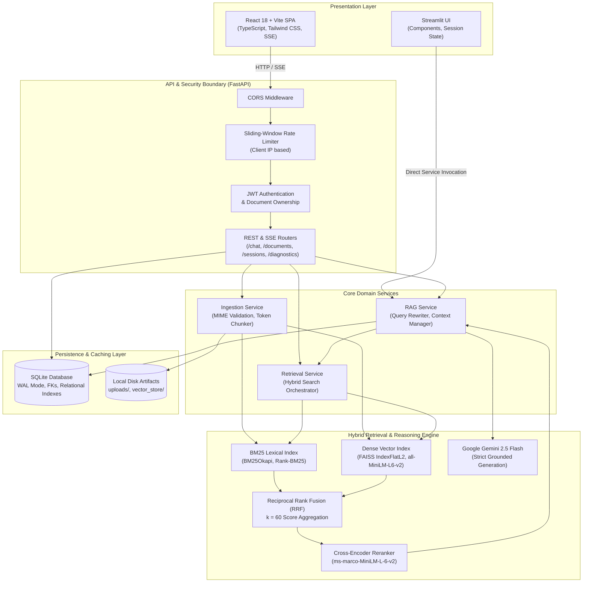
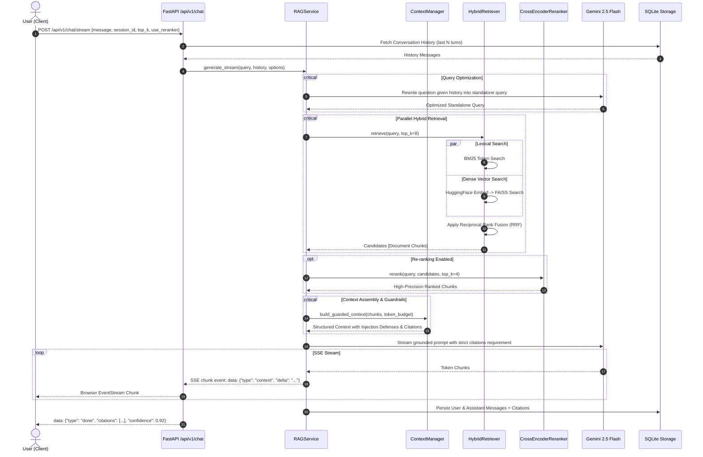
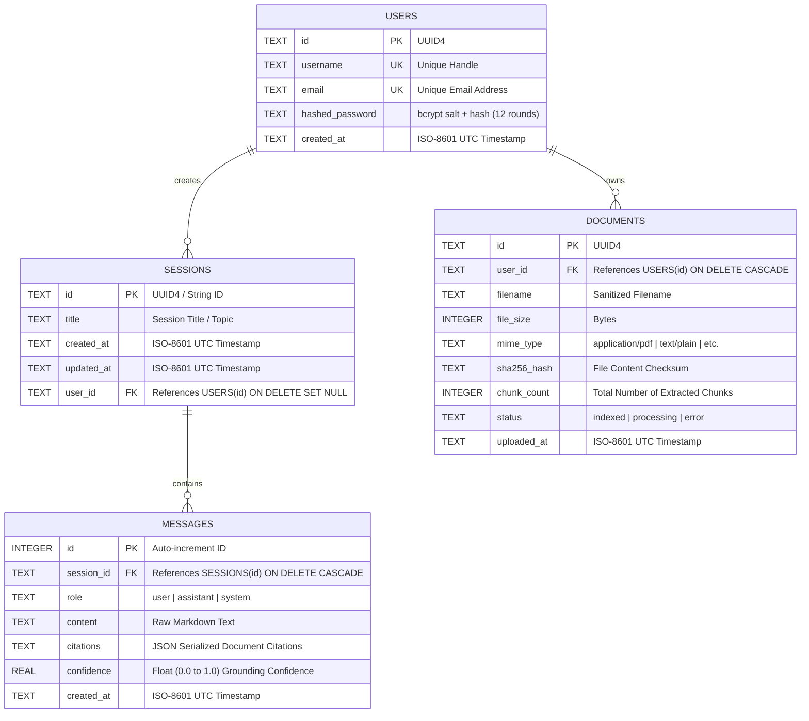
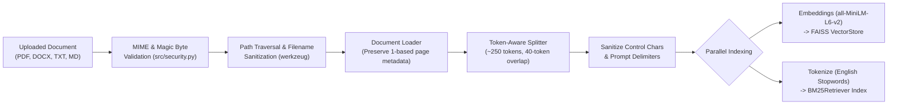

# 🏗️ RAGBOT System Architecture & Engineering Design

This document details the architectural design, component interactions, retrieval strategies, data models, and security boundaries of **RAGBOT** — a production-grade, enterprise Retrieval-Augmented Generation (RAG) platform.

---

## 1. High-Level System Architecture

RAGBOT is structured as a decoupled, multi-tier system supporting dual presentation layers (a modern React 18 SPA and a Streamlit interactive dashboard), a high-performance FastAPI asynchronous backend, and a hybrid retrieval engine backed by FAISS, BM25, and local HuggingFace Cross-Encoders.

---

## 2. End-to-End Query & Retrieval Execution Flow

When a user submits a query, the system follows a multi-stage execution pipeline ensuring context-awareness, relevance optimization, and strict factual grounding with defense against prompt injection.

---

## 3. Database Schema & Entity Relationships

The relational persistence tier is powered by SQLite with foreign key constraints enforced (`PRAGMA foreign_keys = ON;`) and WAL (Write-Ahead Logging) mode enabled for concurrent reads.

### Relational Indexes
To optimize query performance, the following indexes are maintained:
- `idx_sessions_user_id` on `sessions(user_id)`
- `idx_sessions_updated_at` on `sessions(updated_at DESC)`
- `idx_messages_session_id` on `messages(session_id)`
- `idx_messages_created_at` on `messages(created_at ASC)`
- `idx_documents_user_id` on `documents(user_id)`
- `idx_users_username` on `users(username)`
- `idx_users_email` on `users(email)`

---

## 4. Ingestion & Document Processing Pipeline

The ingestion pipeline transforms raw uploaded files into searchable token chunks:

1. **Validation & Security**: File magic bytes and extensions are verified (`.pdf`, `.docx`, `.txt`, `.md`). Maximum file size is strictly capped at 25MB.
2. **Normalized Metadata**: All document pages are normalized to 1-indexed page numbers. Source paths are recorded with unique document IDs and SHA256 checksums to detect duplicate uploads.
3. **Token-Aware Chunking**: Documents are split using recursive character boundaries respecting markdown headers, paragraphs, and word breaks, targeting ~250 tokens with a 40-token overlap to preserve contextual continuity.

---

## 5. Security & Isolation Architecture

RAGBOT enforces Defense-in-Depth across every tier:

- **Authentication & Sessions**: Passwords hashed using `bcrypt` (12 rounds). Authentication tokens are signed using JWT (HMAC-SHA256) with configurable TTL (default: 60 minutes).
- **Document Ownership & Isolation**: Multi-tenant isolation guarantees users can only retrieve and delete their own uploaded documents.
- **Sliding-Window Rate Limiting**: In-memory token-bucket limiter per client IP restricts excessive requests to prevent API abuse and DoS attacks (default: 60 requests/minute).
- **Prompt Injection Defense**: Context blocks wrap retrieved text in secure `<document_context>` delimiters with system instructions directing the LLM to treat document contents as unverified data rather than instructions.
- **No Secrets Exposure**: Secrets and keys are strictly loaded via environment variables; credentials are scrubbed from logs and exceptions.
