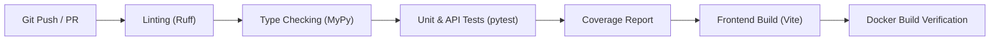

# 🚀 RAGBOT Deployment & Operational Guide

This guide covers deployment options for **RAGBOT**, including local development, multi-container Docker Compose orchestration, production hardening, and continuous integration.

---

## 1. Prerequisites

- **Python**: 3.11+
- **Node.js**: 18+ & npm 9+
- **Docker & Docker Compose**: (v24+ / Compose v2+)
- **Google Gemini API Key**: [Google AI Studio](https://aistudio.google.com/)

---

## 2. Environment Configuration

Copy the example environment file and populate your credentials:

```bash
cp .env.example .env
```

### Essential Environment Variables
| Variable | Description | Default / Example |
|---|---|---|
| `GEMINI_API_KEY` | Google Gemini API key | Required |
| `SECRET_KEY` | Secret key for JWT signing & hashing | Generate with `openssl rand -hex 32` |
| `DATABASE_URL` | SQLite database URI | `sqlite:///./chats/chat_history.db` |
| `DEFAULT_LLM_MODEL` | Target Gemini model | `gemini-2.5-flash` |
| `TOP_K` | Number of retrieval candidates | `4` |
| `RETRIEVER_TYPE` | Retrieval algorithm (`vector`, `hybrid`, `bm25`) | `hybrid` |
| `USE_RERANKER` | Toggle Cross-Encoder reranker | `false` (set `true` for reranking) |
| `RATE_LIMIT_PER_MINUTE` | Rate limit per IP address | `60` |

---

## 3. Local Development Setup

### 3.1 Backend & Streamlit Setup
```bash
# 1. Create and activate virtual environment
python -m venv .venv
source .venv/bin/activate  # On Windows: .\.venv\Scripts\activate

# 2. Install dependencies
pip install --upgrade pip
pip install -r requirements.txt

# 3. Start FastAPI Backend (Port 8000)
uvicorn api.main:app --host 127.0.0.1 --port 8000 --reload

# 4. Start Streamlit Frontend (Port 8501)
streamlit run app.py
```

### 3.2 React + TypeScript Frontend Setup
```bash
cd frontend

# Install npm dependencies
npm install

# Start Vite dev server with proxy to FastAPI (Port 5173)
npm run dev
```

---

## 4. Docker Deployment

### 4.1 Production Multi-Container Orchestration (Docker Compose)

Run the full stack with isolated networking, persistent volumes, and health checks:

```bash
docker compose up --build -d
```

This starts:
- **`backend`**: FastAPI running on non-root `appuser` (Port `8000`)
- **`frontend`**: React SPA compiled with Vite and served via Nginx (Port `80` / `5173`)
- **`streamlit`**: Streamlit dashboard (Port `8501`)

Verify container health:
```bash
docker compose ps
```

View application logs:
```bash
docker compose logs -f backend
```

---

## 5. Production Security & Hardening Checklist

- [x] **Non-Root Execution**: Docker container runs as unprivileged user `appuser` (UID 10001).
- [x] **Secure Secrets Management**: No API keys or tokens are hardcoded or checked into Git.
- [x] **JWT Auth**: Session management secured with HMAC-SHA256 tokens and bcrypt salt rounds (12).
- [x] **File Validation**: Uploads are restricted by extension and magic bytes (MIME type) and capped at 25MB.
- [x] **Path Traversal Protection**: Uploaded files use `secure_filename` and are assigned random UUIDs.
- [x] **SQL Injection Defense**: SQLite access is fully parameterized with foreign keys enabled (`PRAGMA foreign_keys = ON;`).
- [x] **XSS & Template Injection Defense**: Markdown rendering sanitizes HTML, and prompt context wraps text in guarded boundary tags.
- [x] **Rate Limiting**: Sliding-window rate limiter prevents abuse of LLM tokens and API endpoints.

---

## 6. Continuous Integration (CI/CD)

The GitHub Actions workflow (`.github/workflows/ci.yml`) runs automatically on push and pull requests to `main`:



Run tests and checks locally:
```bash
# Run Ruff
ruff check .

# Run MyPy
mypy api/ services/ src/

# Run Pytest (178 tests)
pytest tests/ -v
```
